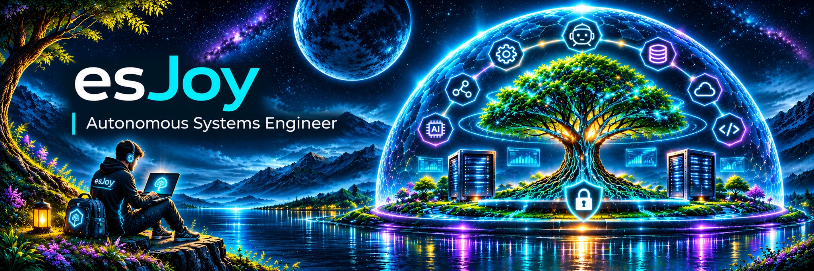

  

# 👋 Hello, I'm esJoy

> I design and build agent-driven systems that keep humans in charge.

I bring Full Stack development, Automation, AI, Infrastructure, and Software Engineering together into interconnected digital ecosystems. I enjoy understanding how independent technologies work and turning them into practical, maintainable systems — built with curiosity, clear documentation, and long-term ownership in mind.

## 🔄 How I Work

  

## 🧭 Engineering Philosophy

- **Understand and service the system.** Favor transparency, documentation, and transferable knowledge.
- **Build for real use.** Prioritize maintainability over unnecessary complexity.
- **Automate with intention.** Preserve human review and control where it matters.
- **Stay adaptable.** Avoid unnecessary dependence on one model, platform, or provider.
- **Keep exploring.** Experimentation is part of the engineering process.

## 🛠️ Focus Areas & Stack

| Area | What it means | With |
| --- | --- | --- |
| **Automation Systems** | Connecting workflows and reducing repetitive operations. | n8n · ComfyUI |
| **AI Integration & Agents** | Model orchestration, tool integrations, practical AI workflows. | Gentle AI · Gentle Shell · Engram · llama.cpp · Cloud models · MCP |
| **Infrastructure & Self-Hosting** | Local environments, containers, cloud services, connected systems. | Linux & Windows · Docker · Cloudflare · Supabase (PostgreSQL), expanding into other databases |
| **Full-Stack Development** | Applications across frontend, backend, APIs, and databases. | — |
| **Systems Architecture** | Services, data, and processes working as a coherent ecosystem. | — |
| **Experiments & Tools** | Exploring new technologies and building useful prototypes. | — |

*Tools and environments I use — not a claim of equal expertise in each. Day to day: Git · GitHub · terminal-first workflows.*

## 🌱 The Dome Connection

[Dome](https://neodome.app) is a framework I'm developing around interconnected, autonomous digital ecosystems.
The dome represents an environment where infrastructure, intelligent agents, workflows, and security work together. The Tree represents growth and adaptation; its roots connect the ecosystem's components while keeping the system understandable and under human control.
Dome is one expression of my engineering philosophy, not the limit of what I design. → **[Visit Dome](https://neodome.app)**

## 🤝 Let's Connect

I'm interested in thoughtful collaborations, technical projects, open source work, and conversations about building better systems.

- 📧 **Email:** [Get in touch](mailto:carlosmz@neodome.app)

<!-- Add a verified email or professional social link here when ready. -->

---

<i>Think independently. Build intentionally. Connect everything.</i>

