# 👋 Hello, I'm esJoy

> I design and build agent systems that keep the user in charge.

I bring full stack development, automation, AI, and infrastructure together into interconnected systems you can see, review and own. I enjoy understanding how independent technologies work and turning them into practical, maintainable ecosystems built with curiosity and clear documentation.

## 🧭 Engineering Philosophy

- **Understand and service the system.** Favor transparency, documentation, and transferable knowledge.
- **Build for real use.** Prioritize maintainability over unnecessary complexity.
- **Automate with intention.** Preserve user review and control where it matters.
- **Stay adaptable.** Avoid unnecessary dependence on one model, platform, or provider.
- **Keep exploring.** Experimentation is part of the engineering process.

  

## 🛠️ Focus Areas & Stack

| Area | What it means | Tools |
| --- | --- | --- |
| **Automation Systems** | Connecting workflows and reducing repetitive operations. | n8n · ComfyUI |
| **AI Integration & Agents** | Model orchestration, tool integrations, practical AI workflows. | [Gentle Stack](https://gentlemanprogramming.com/gentle-shell/) · llama.cpp · Cloud models · MCP |
| **Infrastructure & Self-Hosting** | Local environments, containers, cloud services, connected systems. | Linux & other OS · Docker · Cloudflare · Supabase (PostgreSQL) · other databases in progress |

_The tools and environments I use are not a claim of equal expertise in each. Terminal-first workflows._

## 🧪 The LAB

Self-hosted bench on my own hardware. Workloads and data stay on the machine unless I explicitly decide otherwise and when the work calls for cloud models, they run through the same gated, authenticated paths. Cloud is part of my daily work and the bench is the foundation, not a purity contest. Services are loopback-only by default; anything that must be reached remotely goes through an authenticated gateway, never a raw port. Agents propose, the user reviews, refines, and approves. Nothing ships without passing the gate.
**[LAB](https://github.com/esJoy-dev/LAB)**:

- **Audit first.** Every change starts read-only: inventory, probe, understand then act.
- **Hunt your own leaks.** Audits have caught my own services bound wider than they should be — remediated, documented, runbooked.
- **Post-fix runbooks.** If it surprised me once, it's written down so it can't surprise me twice.

_Methods and lessons are shared at concept level on purpose: never live endpoints, ports, or versions._

## Honorable Mention

[Gentle Shell](https://gentlemanprogramming.com/gentle-shell/) deserves more than a table row. It's my daily driver. The coding agent workspace where keeping the user in charge is the actual runtime: agents iterate, a review gate decides, and nothing ships without my approval. Gratitude to its developer for building control and review into the defaults instead of bolting them on. → **[Field notes from my bench](https://github.com/esJoy-dev/LAB/blob/main/tools/gentle-shell.md)**

Every agent change moves through this loop: agents iterate, the user's gate decides, and only approved work ships. Security runs across every phase.

## 🌱 The Dome Connection

[Dome](https://neodome.app) is a framework I'm developing around interconnected, autonomous digital ecosystems: local agents, self-hosted infrastructure, and workflows that stay under the user's control. Growth and adaptation: roots that connect the ecosystem's components while keeping the system understandable. Dome is one expression of my engineering philosophy, not the limit of what I design. → **[Visit Dome](https://neodome.app)**

## 🤝

I'm interested in thoughtful collaborations, technical projects, open source work, and conversations about building better systems.

- 📧 **Email:** [Get in touch](mailto:carlosmz@neodome.app)

---

<i>Think independently. Build intentionally. Connect everything.</i>

